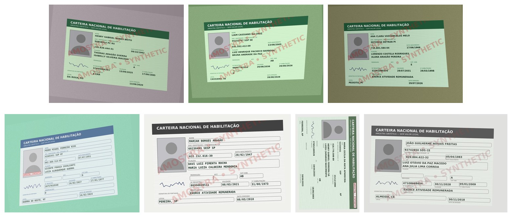

# I tested LangSmith's brand-new smithtune on Brazilian driver's licenses. Here's what it can and can't do

On September 24, 2026, LangChain released **smithtune**, a CLI for LangSmith Fine-Tuning. The promise: take your agent's traces from LangSmith, keep the good ones, fine-tune an open model on managed GPUs, compare it with the original, and deploy it.

I tried it on a problem I care about: **reading Brazilian driver's licenses (CNH)**, the first step of countless onboarding flows in Brazil. Frontier APIs do this well, but they cost money per document and send personal data abroad, which is a real LGPD conversation. Could a small open model do the job instead?

This is a field report from smithtune's first week. Everything is on GitHub, including every bug.

## What smithtune is

A pipeline from **"my agent's history"** to **"a smaller model that behaves like my agent"**:

1. **Curate:** `dataset pull` downloads complete agent runs (*trajectories*) from LangSmith, selected by a filter such as "feedback `exact` = 1". Optionally an **agent council** of LLM judges reviews them against a rubric you write. `dataset push` stores the result as a LangSmith dataset.
2. **Prepare and train:** `prepare` renders every trajectory in the target model's exact chat template (with a pinned tokenizer), and `train` runs LoRA fine-tuning on **Fireworks** or **Baseten**.
3. **Evaluate:** a **replay evaluation** feeds the model each recorded step and asks for the next action. Tools aren't executed, and an LLM judge compares the base and tuned models.
4. **Deploy / undeploy.**

Every paid step needs `--confirm`; without it you get a preview. That turned out to matter.

## The catch: no images

I read the source before planning. In v0.1.0, **trajectories that contain images are filtered out** on purpose, and the trainable base models come from a **fixed list** of text LLMs. So smithtune can't fine-tune an OCR model. That isn't a flaw; it's a text-and-tool-calls product. It just shaped the architecture:

The **Reader** transcribes what's printed, errors included. The **Extractor** is an agent with deterministic tools: CPF and CNH check digits, OCR-fix suggestions (`O→0`, `S→5`), and date rules. It submits a validated record, or rejects the document if it isn't a CNH.

## Stage 1: an OCR model that learned what a CNH "looks like"

I compared three open models from Hugging Face's OCR overview, zero-shot, on synthetic CNHs I generated: fake people with valid check digits, a visible *AMOSTRA / SYNTHETIC* mark, and a layout inspired by the card, not a replica. The general-purpose **Qwen3.5-9B** followed my `LABEL: value` format (72% label accuracy). The OCR specialists **read** perfectly (Chandra 2 found 100% of the values) but ignored the instruction: Chandra wrote its own HTML layout, and PaddleOCR-VL wrote free text.

So I fine-tuned the smallest, **PaddleOCR-VL (0.9B)**, with LoRA on a MacBook (M4 Pro, 1h51, 5.7 GB). One lesson first: my first run ran out of memory, and the log said *49.8% trainable parameters*. mlx-vlm wasn't freezing PaddleOCR-VL's vision tower, which is named `visual` instead of the usual names. **Always read the trainable-parameter line.**

The fine-tuned model scored **99.8% on my synthetic test set.** Then I tested it on **real CNH templates** from the [BID Dataset](https://github.com/ricardobnjunior/Brazilian-Identity-Document-Dataset) (scanned, often upside down; cited, not redistributed):

| Real CNH templates (BID) | Label accuracy | Real CNHs rejected as "not a CNH" |
|---|---|---|
| Round 1: one synthetic design | 32.0% | **48 of 70** |
| Round 2: same images, varied (palettes, fonts, layouts, scans, rotations) | 52.3% | 30 of 70 |
| **Round 3: the model only reads; "is this a CNH?" is decided from the text** | **81.0%** | **0 of 70** |
| Qwen3.5-9B zero-shot, for reference | 48.2% | 5 of 70 |

*Top: round 1, one design. Bottom: round 2, same images, everything that shouldn't matter varied. All cards are synthetic.*

Round 1 read the real cards it accepted almost perfectly. What it had really learned was **"a CNH looks like *my* renderer's card"**, so it rejected most real ones. Two lessons:

- **Synthetic scores can't tell good from bad.** All three rounds scored 99–100% on my synthetic sets; only a real set separated 32%, 52% and 81%. If you fine-tune on synthetic documents, you need at least a small real evaluation set.
- **Let the vision model read, and decide elsewhere.** The biggest jump didn't come from more data or a bigger model. It came from taking the decision the model couldn't generalize and moving it to the text side, where two CNH-only labels (CAT. HAB., Nº REGISTRO…) are enough to decide. The cost: 8 of 72 real RG cards leaked through that simple rule.

## Stage 2: distilling the agent

Stage 2 is smithtune's home turf: record a strong **Teacher** running the Extractor, keep its correct runs, and train a small **Student**.

**Test cheaply first.** I ran 20 transcriptions at a time with Claude Sonnet 5 as the Teacher. Each check found a bug in *my* setup:
- missing lines left "reject" as the only way out;
- the fix then let RG cards pass as "incomplete CNHs";
- my scoring punished the agent for obeying "don't guess accents".

The exact-match rate went 8/20 → 16/20 → 19/20, and **prompt caching** cut the cost of 20 runs from $0.80 to $0.36.

**Then I changed the Teacher.** smithtune asks you to accept its data-rights terms first. They forbid using it to get around model licenses that restrict training on model outputs, and Anthropic's terms restrict using Claude's outputs to train models. I kept the Claude runs out of every dataset and switched to **DeepSeek-V4-Pro, an open-weight model under the MIT license**, served through Baseten. *Check a Teacher's license before you distill it; I should have done it at the planning stage.*

**The Teacher run:** 300 runs, **266 exactly right (89%)**, 44/44 decoys rejected, 0 real CNHs rejected, **$4.84**. Because the data is synthetic, every run has ground truth, which I wrote back to LangSmith as feedback so smithtune could filter on `exact = 1`.

**What happened in smithtune:**
- **The first `dataset pull` found zero traces.** I had written the feedback without `session_id`, and on the first model call (a *child* run) instead of the agent's root run. Filters only see roots. Tip: test the filter with `langsmith trace list --filter` first.
- **Baseten:** `Loops training is not enabled for your workspace`. Training access is gated per workspace.
- **Fireworks:** `prepare` and `train` worked (Qwen3.8-27B, 1 epoch, validation loss 0.013). `plan` gives no dollar estimate, and the only cost lever is `--max-epochs`. The replay evaluation stopped at `63 cases failed; 45/108 saved`: my ~$11 of credit had run out, and smithtune doesn't say why cases fail. On the 45 finished cases, the judge failed *both* base and tuned on 32 of 35 tool calls, because the Fireworks sampler returned tool-call arguments as a parsed object instead of a JSON string. **Read the deterministic metrics before trusting the judge.**

**Plan B: train the Student on the laptop.** smithtune had already done the valuable part, curating 266 correct trajectories into clean train and validation splits. I trained on **exactly those splits** with `mlx-lm`: 838 examples, one per assistant turn, with the history masked.
- **Qwen3.5-9B couldn't be trained on the Mac:** its hybrid linear-attention layers needed 33.6 GB at just 1,024 tokens.
- So the Student is **Qwen3-8B**: 3.5 hours on the M4 Pro, 10 GB peak, validation loss 0.672 → 0.013.
- **One last silent bug:** mlx-lm's server (0.31.3) ignores `--adapter-path` ([already fixed on main](https://github.com/ml-explore/mlx-lm/pull/1249), not yet released). My first "tuned" evaluation was the base model again, 100/100 identical. Sending the adapter with each request fixed it.

## The numbers that matter

I scored the Extractor field by field on 100 held-out transcriptions (CNHs with OCR noise, plus decoys):

| Extractor | Exactly right | Field accuracy | Decoys rejected | Cost per 1,000 CNHs |
|---|---|---|---|---|
| Teacher: DeepSeek-V4-Pro (API) | 89%* | 99.3% | 44/44 | ~$16 |
| Qwen3-8B, not tuned (local) | 46% | 93.1% | 12/14 | $0 |
| **Qwen3-8B + LoRA (local)** | **81%** | **96.6%** | **14/14** | **$0** |

*The Teacher was scored on training-distribution items, not the same 100 (same generator). "$0" means no per-document fee on hardware you already own.

**One epoch took a local 8B model from 46% to 81%, about 90% of the way to the Teacher, at no per-document cost.** It also learned the Teacher's *habits*: it rejects every decoy and validates before submitting (6.2 → 8.2 tool calls per run, against the Teacher's 7.6). What remains is mostly the field the Teacher also misses, the RG number, which has no check digit.

## Verdict on smithtune v0.1

**What I liked:**
- the right loop ("traces → curated dataset → LoRA → evaluation → deploy");
- careful engineering: pinned tokenizers, `--confirm` on paid steps, no default rubric;
- data-rights terms that made me check my Teacher's license.

Its **curation and preparation paid off even when training happened elsewhere.**

**What to know first:**
- text and tool calls only;
- check provider access and budget before you start (Baseten is gated; Fireworks has no estimate or spend cap);
- put feedback on the root run, with `session_id`;
- in v0.1 the replay evaluation is fragile for tool-heavy agents;
- check your Teacher's license.

**What I'd love in v0.2:**
- multimodal trajectories;
- a cost estimate and spend cap on Fireworks;
- reasons for failed evaluation cases;
- evaluation that accepts tool-call arguments as objects.

The total cost of the experiment was about $23 in API and training credit, plus a lot of MacBook hours. The most useful lesson wasn't about smithtune at all: **every silent bug I hit showed up only as a number that couldn't be true.** When a result looks too good or too identical, stop and look.

---

**Full write-up, code and every bug:** [github.com/ricardocunha/ensaios › articles/2026-10-cnh-ocr-smithtune](https://github.com/ricardocunha/ensaios/tree/main/articles/2026-10-cnh-ocr-smithtune) · Dataset: [synthetic-cnh-br](https://huggingface.co/datasets/ricardopcunha/synthetic-cnh-br) · Adapters: [Reader](https://huggingface.co/ricardopcunha/paddleocr-vl-cnh-reader-lora-mlx), [Extractor](https://huggingface.co/ricardopcunha/qwen3-8b-cnh-extractor-lora-mlx) · Issues filed: [smithtune #103](https://github.com/langchain-ai/smithtune/issues/103), [mlx-vlm #2399](https://github.com/Blaizzy/mlx-vlm/issues/2399)

*All documents in this project are synthetic. No real person's data was used for training.*

#MachineLearning #LLM #FineTuning #OCR #LangChain #OpenSource #Brazil
