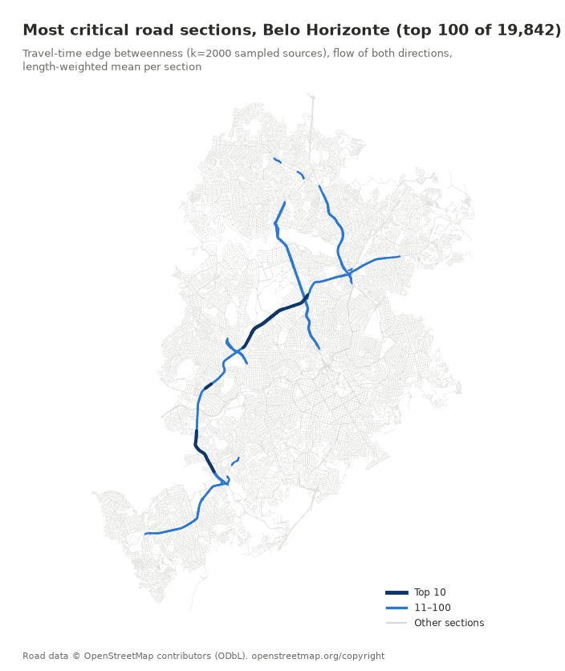
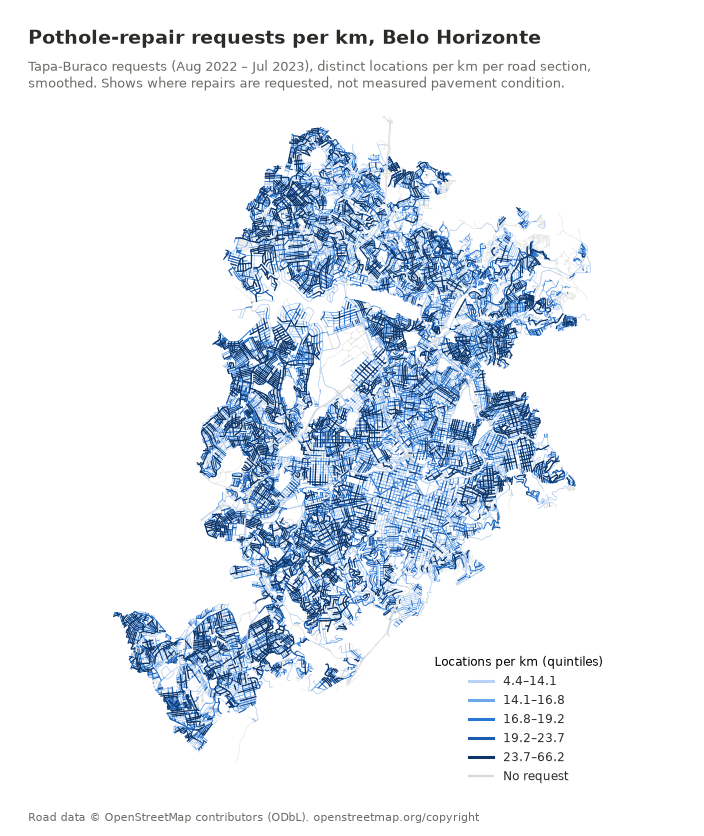

# Graph agents that plan road maintenance

A city has more potholes than money. Someone has to decide which streets get resurfaced this year and in what order, without closing two roads at once that together cut a neighbourhood off from its hospital. It sounds like a job for an agent.

I built that agent system on Belo Horizonte's real road network and a year of real pothole-repair requests, and compared it with a plain optimisation baseline. The idea is project #3 of the video *"5 AI Agents Projects to Build in 2026"*; the architecture and code are my own. Deterministic tools do the graph math. The LLM, **Qwen3-8B running locally** at no cost per call, only does the reasoning: which sections to add or drop, which works to schedule together, and how to explain the plan.

Short version: on this problem the solver already makes the plan, a simple heuristic schedules better, and the LLM adds explanation plus a small shift towards streets with more requests. The interesting part is *how* it failed.

## The graph and the data

Belo Horizonte's OpenStreetMap drive graph has **32,311 nodes and 82,984 edges**. Travel times are OSMnx's free-flow estimates, so every delay below is a lower bound.

**Criticality** is travel-time-weighted edge betweenness: how many shortest paths run through a road. Exact betweenness would take an estimated 69–86 minutes on my laptop, so I sample **2,000 source nodes** (321.1 s). On Porto Alegre, where the exact run finished, that sample recovered 0.98 of the exact top-100 edges.

Edges are the wrong unit: a city resurfaces a stretch of street, not an OSM edge. I merge consecutive edges with the same name and road class into **19,842 sections** (median 163 m).

*Top 100 of 19,842 sections by sampled betweenness. Road data © OpenStreetMap contributors (ODbL), openstreetmap.org/copyright.*

Betweenness is not closure impact, though. Closing the top section of the Anel Rodoviário ring motorway delays 112 of 1,000 sampled trips by a mean of 42.5 s. Closing a section of Avenida Quatro Mil Cento e Setenta e Dois, only 8th on the list, delays 111 trips by **388.9 s**, because there's no good detour.

The condition data is Belo Horizonte's open service-request data (BH Digital, CC-BY). From August 2022 to July 2023, the newest month published, there are **198,991 Tapa-Buraco (pothole-repair) requests**; **95.0%** snap to a road within 30 m.

*Tapa-Buraco requests, Aug 2022 – Jul 2023: distinct locations per km per section, smoothed. Shows where repairs are requested, not measured pavement condition. Road data © OpenStreetMap contributors (ODbL), openstreetmap.org/copyright. Requests: Prefeitura de Belo Horizonte, BH Digital, dados.pbh.gov.br, CC-BY.*

This measures **who reports**, not pavement. Residential streets get **21.0** request locations per km; the Anel gets **0.10**, and in this window it was a federal highway maintained by DNIT anyway (the city took over 22.4 km of it in June 2025). Condition and criticality are nearly unrelated (Spearman **−0.09**).

So a section's **value** is condition × criticality × km. The repair **cost** is synthetic (pavement area scaled by condition), in m², not reais.

## The baseline is already almost optimal

Choosing what to fix within a budget is a knapsack over **11,860 candidate sections**. Greedy by value per cost lands within 1e-5 of the exact optimum, in a fraction of a second.

| Budget | Sections | Value captured | Requests covered |
|---|---:|---:|---:|
| 5% | 445 | 54.43% | 5.36% |
| 10% | 952 | 70.24% | 10.89% |
| 20% | 1,997 | 83.98% | 21.65% |

The solver buys arterials, not the residential streets with the most requests. That gap is where I expected an agent's judgment to matter.

There's a second bar. The plan's **15 most critical sections** are major works that close the road, to be scheduled into 3 months. A **violation** is a month whose works, closed together, cut hospital or school access that no single work cuts alone. Scheduling in priority order gives 1 violation at every budget. A small deterministic heuristic (pairwise conflict check, greedy fill, swaps) gives **0**, with a worst month 17–27% lower.

## Three agents and an audit

All three are Pydantic AI agents with typed outputs; the hand-off between them is plain code.

- **Maintenance agent:** proposes adds and removes to the solver plan, each with a reason. The solver rebuilds the plan around them, so budget feasibility is never the LLM's job.
- **Closure agent:** assigns the 15 major works to months, with tools that score a schedule and name conflicting pairs.
- **Coordinator:** writes the quarterly plan from a fact sheet the tools computed.

The **audit** uses no LLM: value against the solver, the schedule rescored by the same tool, and every number in the prose looked up in a ledger of what the tools returned. I ran **3 pipelines at each of 3 budgets**: 9 runs, 37 minutes.

## Results

### Maintenance: small coverage gains, paid for in value

It completed 8 of 9 runs. Final plans kept **93.8–100%** of the solver's value and moved request coverage by **−0.04 to +1.08 points**. The runs that added the most-requested residential streets (Rua Joviano Coelho, 509 requests) gained 0.75 to 1.08 points for 0.6–6.2% of the value.

That's a real preference, fix what citizens report, but it fits in the solver's objective as one weight. And the agent wasn't consistent: the mean overlap (Jaccard) of its deviations across reruns was **0.137** at 5% and **0.000** at 10%. It also ignored "at most 6 deviations": 4 of the 8 accepted proposals had 10–12.

### Closure: 1 of 9

This is the main finding. The closure agent produced a schedule in **1 of 9 runs**.

**6 of the 8 failures come from one malformed id.** Rua Juarez Teixeira Pinto, section **S10128**, is the only work id that doesn't start with `S0`. In 6 runs the model wrote it **`S010128`**. The tool answered `unknown section ids: ['S010128']`, and in 4 of those runs the model resent the identical call until its retries ran out. It never typed `S10128`.

**The other 2 failures are loops.** The tool said which pair conflicted. One run kept that pair together for all 14 calls; the other separated it and made a new conflict. Both sent **the same schedule 8 times**, despite an instruction not to. Many of those schedules had works duplicated or missing, and my tool scored them anyway: a tool-design gap on my side.

The one success avoided the violation and copied all its numbers correctly, but stacked the Anel, Antônio Carlos, Dom Pedro I and the 388.9-second section into one month:

| Schedule (same 15 works) | Violations | Worst-month delay |
|---|---:|---:|
| Naive | 1 | 58,766.9 s |
| Heuristic (no LLM) | **0** | **51,731.9 s** |
| Agent | **0** | 66,627.6 s |

Its worst month is **28.8% worse than the heuristic's**.

### What a number audit can vouch for

The strict audit found **227 of 253** prose numbers in the ledger (89.7%). Of the 26 misses, 20 were correct values in scientific notation that my audit misread (an audit bug) and 3 were correct derived numbers like 100 − 51.04. With those credited: **250 of 253 (98.8%)**, and the coordinator goes to **108/108**. The three unsupported numbers are all the maintenance agent's claims about its own effect, such as a claimed 3.77-point improvement where its own tool call had shown a 4.2-point loss.

Reading the texts showed the limit. The coordinator wrote that a plan "gave up 1.08%" of requests; it *gained* 1.08 points. The lookup credited it, because 1.08 is in the ledger. "Every number is traceable" is reachable with an 8B model. "Every sentence is right" is a different property.

## The verdict

| | Solver + heuristic | LLM agents (Qwen3-8B) |
|---|---|---|
| Value captured | 54.43 / 70.24 / 83.98% | 93.8–100% of the solver's |
| Requests covered | 5.36 / 10.89 / 21.65% | −0.04 to +1.08 points |
| Schedule completed | 9/9 | 1/9 |
| Worst-month delay (the one comparable case) | 51,731.9 s | 66,627.6 s |
| Same answer on rerun | yes | deviation overlap 0.0–0.87 |

On this problem the LLM adds **explanation and small shifts in request coverage, not better plans**. A plan with its trade-offs written out is something a city engineer can read and argue with. But the decision belongs to the solver.

## What I'd tell a team

1. **Build the deterministic baseline first, and make the agent beat it.** Without one, the agent's plans would have looked fine.
2. **If the agent's "judgment" is a preference, put it in the objective.** Reproducible, explainable, free.
3. **Don't make the model type ids.** Give it a closed list, resolve in code, and say which id it probably meant.
4. **Make tools reject impossible inputs and stop repeated calls in code.** Instructions stopped neither.
5. **A number audit shows where a number came from, not whether the sentence is right.** Move every claim that matters into typed fields code can recompute.
6. **Pothole requests measure reporting, not pavement.**

---

**Code, data pipeline and every number:** [github.com/ricardocunha/ensaios › articles/2026-11-road-network-graph-agents](https://github.com/ricardocunha/ensaios/tree/main/articles/2026-11-road-network-graph-agents)

*Road data © OpenStreetMap contributors (ODbL). Pothole requests: Prefeitura de Belo Horizonte, BH Digital, CC-BY; figures show only per-section aggregates, never single requests. Repair costs are synthetic and travel times are free-flow. Idea: "5 AI Agents Projects to Build in 2026" (project #3).*

#AI #Agents #LLM #GraphAlgorithms #OpenStreetMap #UrbanPlanning #OpenData #Brazil
