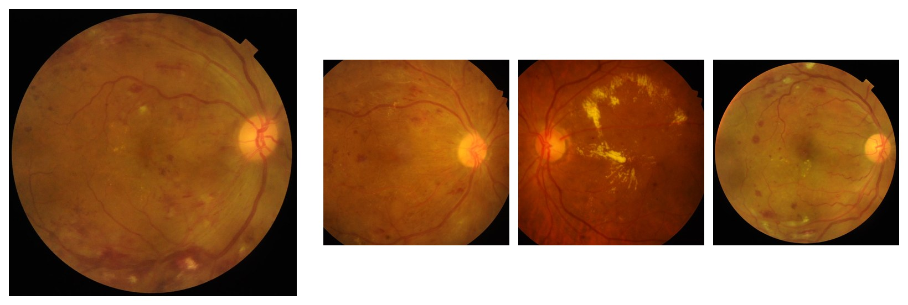

# My eye-scan RAG cited its sources. It was reading the labels.

> **Research demo, not a medical device.** Every number below is agreement with the labels of one public dataset, not diagnostic accuracy on patients.

The pitch for multimodal medical RAG: a vision-language model looks at a retinal photo, you put the most similar labelled photos from an archive next to it, and the model diagnoses the new one and cites the cases it relied on. Its answer is now "grounded" and "explainable".

I built one, entirely on a laptop, on 3,200 public retinal photos, and compared it with the same model alone and with a plain nearest-neighbour vote. Then I ran the test I think every system like this needs: **keep the retrieved photos, swap their labels for wrong ones, and see what the model does.** The idea is project #2 of the video *"5 AI Agents Projects to Build in 2026"*; the architecture, code and numbers are mine.

The short version: retrieval lifted the model's macro-F1 from 0.058 to 0.298, which was still below the nearest-neighbour vote (0.341). With shuffled labels, the whole gain vanished (0.056, indistinguishable from no retrieval). A citation check passed 90 % of explanations with true labels and 89 % with shuffled ones.

## Why this matters in Brazil

Brazil has **BRSET** (Nakayama et al., *PLOS Digital Health*, 2024): 16,266 fundus photos of 8,524 patients from three centres in São Paulo, with disease, image-quality and demographic labels. It's five times the data I used, from Brazilian patients. But it needs credentialed PhysioNet access (an account, an ethics course and a signed agreement), and this project doesn't sign up for accounts. So the pipeline runs on a public dataset and is built so that anyone with access can swap in BRSET. The evaluation below is the part worth reusing.

## The setup

Everything runs locally on an M4 Pro:

- **Embeddings:** BiomedCLIP image embeddings.
- **Search:** a Qdrant index with hybrid search (image vectors plus sparse text).
- **Diagnosis:** Qwen3-VL-8B at 4 bits, answering with typed JSON: labels from the dataset's 45 condition codes, or "normal".
- **Explanation agent:** cites the cases behind each label.
- **Citation check:** code, not a model, verifies the citations.

**Data: RFMiD 1.0**, 3,200 photos from three cameras in India, 45 conditions, an official split, CC BY 4.0. I score macro-F1 over the 16 conditions with at least 20 training images.

**Fixing the data first.** I checked all 5.1 million image pairs for the same eye by matching the retina's vessel pattern. Embedding similarity and perceptual hashes both failed at this. The check found 154 same-eye pairs, and 31 test images with the same eye in an earlier split. From the three arms on, those are excluded, leaving 609 test images. The bigger surprise: **54 % of same-eye pairs carry different labels**, and among the 8 near-identical photo pairs, 7 do. That limits what any method can score against these labels.

## A vector lookup is hard to beat

The plain kNN vote predicts a label when it has a similarity-weighted share of at least 0.20 among the 20 nearest training images. On all 640 test images it scores **0.339** (0.341 without the duplicates). BiomedCLIP's text-prompt zero-shot scores 0.141, and predicting every label scores 0.108.

RFMiD has no text reports, only labels. So each case's "report" is generated from its labels, and the query's text side has to come from somewhere available at test time. Using the kNN vote's labels raised label precision at 3 from 0.277 to 0.329. Using the vision model's own zero-shot labels made it worse than no text at all (0.243): it called 60 % of test images "media haze", against 17 % true.

## Retrieval helps the model, and still loses

Results on the same 609 test images, with 95 % paired bootstrap intervals:

| Arm | macro-F1, 16 frequent | s / image |
|---|---|---|
| VLM alone | 0.058 (0.042–0.077) | 5.2 |
| **VLM + 3 retrieved cases** | **0.298** (0.249–0.344) | 7.5 |
| kNN vote | 0.341 (0.304–0.380) | < 0.01 |

The model alone is below the "predict everything" floor. Retrieval adds 0.24, and its interval (+0.187 to +0.286) is well clear of zero. But compared with the kNN vote it is built on, the difference is −0.043 (−0.084 to −0.006): not better, and the point estimate is slightly worse. And in 74 % of answers, every label appears in one of the three cases shown. Is it comparing photos, or copying labels?

## Same photos, wrong labels

I re-ran the retrieval arm with the same three photos per image, each shown with a random other training case's findings, never one of its real ones:

| Arm (same 609 images) | macro-F1 |
|---|---|
| VLM alone | 0.058 |
| VLM + cases, true labels | 0.298 |
| VLM + cases, **shuffled labels** | **0.056** (0.044–0.069) |

**The whole gain disappeared.** Shuffled-label retrieval is indistinguishable from no retrieval (difference −0.002, CI −0.023 to +0.016). 58 % of answers changed when only the labels changed. In 29 % of images, the model gave a label that appeared only in the wrong text: not in the real cases, not in its own zero-shot answer, and not true for the image.

## A citation check that passes either way

For each label, the explanation agent says whether it came from the photo, the cases or both, and cites case numbers. Code then checks that the citations exist, that the source matches them, and that **every cited case actually records the label it's cited for**. Failures go back to the model, up to two retries.

| | true labels | shuffled labels |
|---|---|---|
| verified by the check | 90.0 % | 89.3 % |
| verified citations naming a label the image really has | 48.8 % | 12.2 % |
| verified findings claiming "seen in the photo", no case | 28 % | 49 % |

The check did its job. It caught hundreds of cases cited for labels they don't carry, and feedback fixed most of them. But its job was consistency with the text shown, and that text was wrong.

*Test image 205 (left) and its three retrieved cases. Same photos, different labels next to them, different diagnosis. Images: RFMiD (Pachade et al., 2021), CC BY 4.0, cropped and resized.*

One example, image 205 from the test set, verified on the first try. The image is labelled diabetic retinopathy, and its three real retrieved cases all carry it too. With case 1 relabelled as macular degeneration, the model answered macular degeneration, cited case 1, and explained: *"The QUERY photograph shows signs of age-related macular degeneration, consistent with the finding in reference case 1, which was also labeled ARMD."* Every check passed.

## What I'd tell a team building this

1. **Run a shuffled-labels test before calling anything "grounded".** It's one more run. Here it took every point of the gain.
2. **Compare with the nearest-neighbour vote**, not just with the model alone. "Retrieval improves the VLM by 0.24" is true and misleading.
3. **A citation check proves consistency, not correctness.** Keep it; it catches real mistakes. Then measure separately whether the cited claims are true.
4. **Don't trust "I see it in the image".** It's a generated sentence. Change what the model could have used, and watch what moves.
5. **Audit duplicates and labels before the model.** More than half the same-eye pairs here disagree on the labels.

This is one dataset, one 8B model at 4 bits, one prompt, and none of it is diagnostic accuracy. The intervals cover which images were drawn, not a different model, prompt or dataset. A stronger model might compare photos better, and the shuffled-labels test is exactly how you'd find out.

---

*Idea from the video "5 AI Agents Projects to Build in 2026" (project #2). Data: RFMiD 1.0, Pachade et al., Data 2021, 6(2), 14, doi:10.3390/data6020014, CC BY 4.0. Models: BiomedCLIP (MIT, research use) and Qwen3-VL-8B-Instruct (Apache-2.0), run locally. BRSET: Nakayama et al., PLOS Digital Health, 2024. Not a medical device. Code and every number: [github.com/ricardocunha/ensaios › articles/2027-01-multimodal-medical-rag-eye](https://github.com/ricardocunha/ensaios/tree/main/articles/2027-01-multimodal-medical-rag-eye).*
